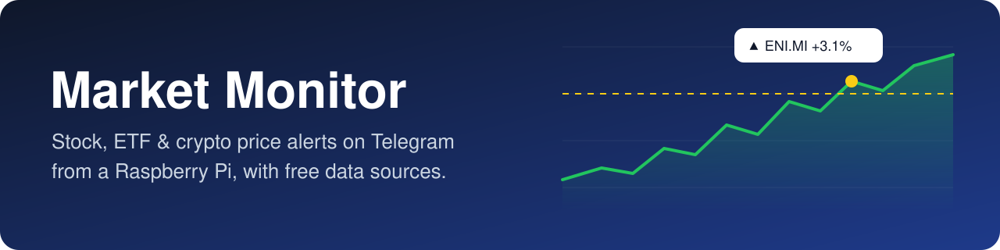
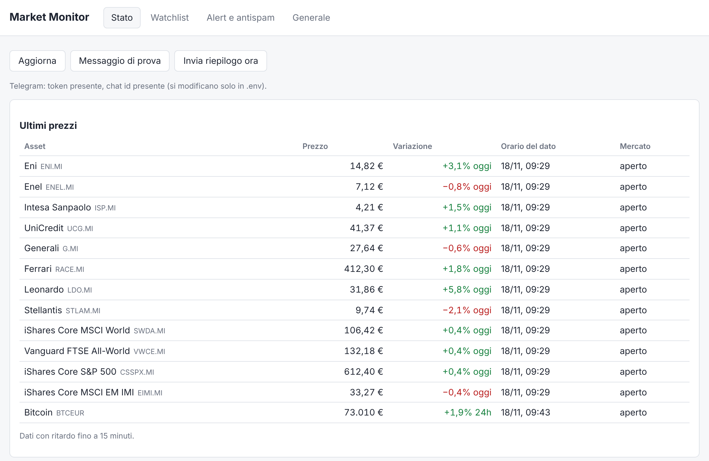
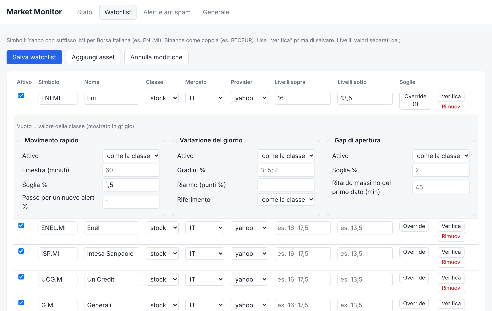
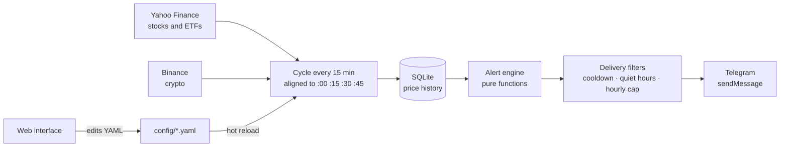
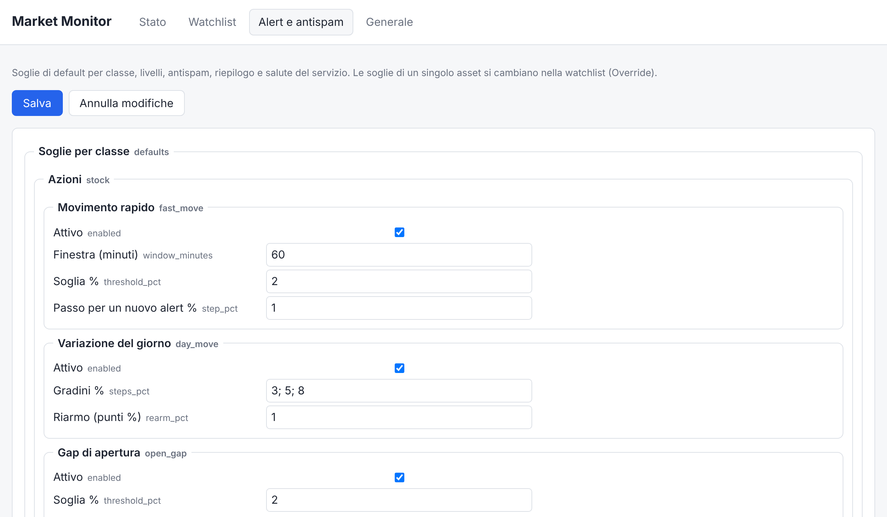

<p align="center">
  
</p>

<p align="center">
  <a href="https://github.com/fedeveloper/market-monitor/actions/workflows/tests.yml"></a>
  <a href="LICENSE"></a>
  
  
  
  
</p>

<p align="center">
  
  
  
  
  
</p>

<p align="center">
  <b>A tiny, self-hosted price watcher.</b> It checks your stocks, ETFs and crypto every 15 minutes,<br>
  applies the alert rules you choose and pings you on Telegram. No paid APIs, no cloud, no Docker.
</p>

<p align="center">
  <a href="#-quick-start">Quick start</a> ·
  <a href="#-usage">Usage</a> ·
  <a href="#-web-interface">Web interface</a> ·
  <a href="#-alert-rules">Alert rules</a> ·
  <a href="#-cheat-sheet">Cheat sheet</a> ·
  <a href="#-components-and-licenses">Licenses</a>
</p>

---

## ✨ Features

- **Stocks, ETFs and crypto** from free sources: Yahoo Finance for exchanges (e.g. Borsa Italiana, NYSE, Nasdaq) and Binance for crypto pairs.
- **Smart alerts, not noise**: fast moves, daily moves in steps (3% → 5% → 8%), opening gaps and your own price levels, with cooldown, hysteresis, quiet hours and an hourly cap.
- **One Telegram message per cycle**, grouped by asset, plus a **daily digest** at 18:00 that doubles as a heartbeat.
- **Web interface** to edit the watchlist, thresholds and settings from your phone, with validation before every save.
- **Hot reload**: change the watchlist or the rules and they apply on the next cycle, no restart.
- **Built for a Raspberry Pi 3B**: under 60 MB of RAM, idle CPU between cycles, one small SQLite write per cycle to spare the SD card.
- **Two dependencies** (`requests`, `PyYAML`), Python 3.11 standard library for the rest. 290+ offline tests.
- **Reports data, never advice**: messages show prices and the thresholds that were crossed, nothing else.

> [!NOTE]
> Telegram messages and the web interface are in Italian, with Italian number formatting (`14,52 €`, `+3,1%`). Code and configuration keys are in English.

## 📸 Screenshots

<table>
  <tr>
    <td width="50%"></td>
    <td width="50%"></td>
  </tr>
  <tr>
    <td align="center"><sub>Status: latest prices, recent alerts, provider health</sub></td>
    <td align="center"><sub>Watchlist: tickers, price levels and per-asset overrides</sub></td>
  </tr>
</table>

A Telegram alert looks like this:

```text
Market Monitor · 14:30

▲ Eni (ENI.MI)  14,52 €
   +2,3% in 1 ora · +3,1% oggi (gradino 3%)

▼ Bitcoin (BTCEUR)  62.310 €
   −3,4% in 1 ora · −5,2% in 24 ore (gradino 5%)

Dati con ritardo fino a 15 minuti.
```

## ⚙️ How it works



- Markets with opening hours (e.g. Milan 09:00–17:30, New York 09:30–16:00) are only polled while open; crypto runs 24/7.
- Free exchange data is delayed by about 15 minutes, so a stock alert reaches you 15–30 minutes after the move. Crypto data is real time.
- A provider that fails never blocks the others, and the loop never stops on an error. After a few failed cycles you get one error message, then one recovery message.

## 🚀 Quick start

### Requirements

- Raspberry Pi 3B or newer (or any Linux box) with **Python 3.11** and `systemd`.
- A **Telegram bot** (create one with [@BotFather](https://t.me/BotFather)) and your **chat id** (in a private chat it is your Telegram user id).

### 1. Install

```bash
sudo apt install -y git python3-venv tzdata
cd ~
git clone https://github.com/fedeveloper/market-monitor.git
cd market-monitor
python3 -m venv .venv
.venv/bin/pip install -r requirements.txt
```

### 2. Configure

```bash
cp .env.example .env                    # secrets: bot token, chat id, web password
nano .env
chmod 600 .env

cp config/config.example.yaml    config/config.yaml      # schedule, markets, providers, logs
cp config/watchlist.example.yaml config/watchlist.yaml   # the assets you follow
cp config/alerts.example.yaml    config/alerts.yaml      # alert rules and anti-spam
```

`.env` holds the only secrets:

```ini
TELEGRAM_BOT_TOKEN=123456789:your-bot-token
TELEGRAM_CHAT_ID=123456789
WEB_PASSWORD=at-least-8-characters
```

### 3. Check

```bash
export PYTHONPATH=src
.venv/bin/python -m market_monitor check-config      # is the configuration valid?
.venv/bin/python -m market_monitor check-symbols     # does every ticker answer?
.venv/bin/python -m market_monitor test-telegram     # does the test message arrive?
.venv/bin/python -m market_monitor run --once --dry-run   # one cycle, nothing sent or saved
```

### 4. Run as a service

```bash
for unit in market-monitor market-monitor-web; do
  sed -e "s#User=pi#User=$USER#" -e "s#/home/pi/market-monitor#$HOME/market-monitor#g" \
      deploy/$unit.service | sudo tee /etc/systemd/system/$unit.service > /dev/null
done
sudo systemctl daemon-reload
sudo systemctl enable --now market-monitor market-monitor-web
journalctl -u market-monitor -f          # Ctrl+C to stop watching the log
```

You should see `service started`, then a `cycle done` line every quarter of an hour. Open the web interface at `http://<raspberry-ip>:8080` (find the IP with `hostname -I`).

## 🧭 Usage

### Commands

All commands run from the project folder with `PYTHONPATH=src .venv/bin/python -m market_monitor <command>`.

| Command | What it does |
|---|---|
| `run` | Main loop (this is what the service runs) |
| `run --once` | One cycle, then exit |
| `run --once --dry-run` | One cycle, messages printed instead of sent, database untouched |
| `check-config` | Validates the three YAML files and `.env`, lists each asset with its effective rules |
| `check-symbols` | Queries every ticker and shows price, change and data delay |
| `test-telegram` | Sends a test message |
| `digest --now` | Sends the daily digest right away (`--dry-run` to preview it) |
| `status --print` | Prints the JSON status file, if enabled |
| `web` | Starts the web interface |

### Your watchlist

Edit `config/watchlist.yaml` (or use the web interface). Changes apply on the next cycle.

```yaml
assets:
  - {symbol: ENI.MI,  name: Eni,     class: stock,  market: IT,     provider: yahoo}
  - {symbol: AAPL,    name: Apple,   class: stock,  market: US,     provider: yahoo}
  - {symbol: VWCE.MI, name: Vanguard FTSE All-World, class: etf, market: IT, provider: yahoo}
  - symbol: BTCEUR
    name: Bitcoin
    class: crypto
    market: CRYPTO
    provider: binance
    levels: {above: [75000], below: [50000]}      # your own price levels
    overrides:
      fast_move: {threshold_pct: 4.0}             # stricter than the crypto default
```

Yahoo symbols use the exchange suffix (`.MI` for Milan, none for US stocks); Binance symbols are pairs such as `BTCEUR` or `ETHEUR`. Run `check-symbols` after adding one.

### 🌐 Web interface



- **Stato**: latest prices, recent alerts, provider health, buttons to send a test message or the digest.
- **Watchlist**: add, remove or pause assets, set price levels and per-asset thresholds, check a ticker before saving.
- **Alert e antispam** and **Generale**: every setting of `alerts.yaml` and `config.yaml`.

Every save is validated with the same rules as `check-config`. Nothing is written if something is wrong, the previous file is kept as `.bak`, and the write is atomic. The interface runs as a separate service: if it breaks, monitoring goes on.

> [!WARNING]
> The interface speaks plain HTTP and is meant for your home network, protected by `WEB_PASSWORD`. Do not forward port 8080 on your router. From outside, use a VPN such as Tailscale (`sudo tailscale serve --bg 8080` even gives you HTTPS) or an SSH tunnel. Details in [docs/WEB.md](docs/WEB.md).

## 🔔 Alert rules

Defaults per asset class live in `config/alerts.yaml`; any field can be overridden per asset.

| Rule | Fires when | Default (stock · ETF · crypto) |
|---|---|---|
| `fast_move` | The price moves quickly within a window | 2.0% · 1.2% · 3.0% in 60 min |
| `day_move` | The day change crosses a step, once per step | 3/5/8% · 2/4/6% · 5/8/12% (crypto: rolling 24 h) |
| `open_gap` | The session opens far from the previous close | 2.0% · 1.0% · off |
| `level_above` / `level_below` | The price crosses one of your levels | your levels, 0.5% hysteresis |

Anti-spam on top of the rules:

| Mechanism | Default |
|---|---|
| Cooldown per asset and rule | 120 min |
| Quiet hours (urgent moves still go through) | 23:00–07:00 |
| Messages per hour | 6 |
| Alerts per message | 10, then "+N more" |
| Daily digest | 18:00; weekends crypto only |

Suppressed alerts are not lost: if the condition still holds when quiet hours end, the alert is sent then. The full catalogue is in [docs/ALERTS.md](docs/ALERTS.md).

## 📋 Cheat sheet

```bash
cd ~/market-monitor

# Update to the latest version
git pull && .venv/bin/pip install -r requirements.txt
PYTHONPATH=src .venv/bin/python -m market_monitor check-config
sudo systemctl restart market-monitor market-monitor-web

# Restart, stop, start
sudo systemctl restart market-monitor market-monitor-web
sudo systemctl stop    market-monitor market-monitor-web
sudo systemctl start   market-monitor market-monitor-web

# Is it running? What is it doing?
systemctl status market-monitor --no-pager
journalctl -u market-monitor -n 30 --no-pager
journalctl -u market-monitor -f            # live, Ctrl+C to exit
```

| You changed… | Restart needed? |
|---|---|
| `watchlist.yaml`, `alerts.yaml`, `config.yaml` (by hand or from the web) | No, applied on the next cycle |
| `.env` (token, chat id, web password) | `sudo systemctl restart market-monitor market-monitor-web` |
| `web.host` / `web.port` | `sudo systemctl restart market-monitor-web` |
| The code (`git pull`) | `sudo systemctl restart market-monitor market-monitor-web` |

## 🛠️ Troubleshooting

| Symptom | Where to look |
|---|---|
| The service does not start | `journalctl -u market-monitor -n 50 --no-pager`, then `check-config` |
| Web interface: `status=78/CONFIG` | `WEB_PASSWORD` missing or shorter than 8 characters in `.env` |
| `HTTP 400 (Bad Request: chat not found)` | Wrong chat id, or you never wrote to the bot |
| Binance answers `HTTP 451` | Set `providers.binance.base_url: https://data-api.binance.vision` |
| A ticker shows `ERRORE` in `check-symbols` | Wrong symbol or suffix in the watchlist |
| No digest at 18:00 | The service is stopped: `systemctl status market-monitor` |

## 📚 Documentation

The detailed guides are in Italian.

| Guide | Content |
|---|---|
| [docs/DEPLOY.md](docs/DEPLOY.md) | Full installation, acceptance tests and resilience checks on the Pi |
| [docs/ALERTS.md](docs/ALERTS.md) | Alert catalogue, steps, re-arming, anti-spam, digest |
| [docs/WEB.md](docs/WEB.md) | Web interface, security, remote access with Tailscale |
| [docs/STATUS_FILE.md](docs/STATUS_FILE.md) | Optional JSON status file for other programs |
| [docs/ARCHITECTURE.md](docs/ARCHITECTURE.md) | Design decisions, data model, provider formats |
| [docs/ROADMAP.md](docs/ROADMAP.md) | Milestones and project history |
| [docs/README.it.md](docs/README.it.md) | Italian quick reference |

## 🧩 Project structure

```text
market-monitor/
├── src/market_monitor/
│   ├── providers/      Yahoo Finance and Binance clients (timeouts, retries, 429 handling)
│   ├── alerts.py       alert engine, pure functions
│   ├── delivery.py     cooldown, quiet hours, hourly cap, batching
│   ├── notifier.py     Telegram sendMessage, message splitting
│   ├── service.py      the cycle and the service loop
│   ├── storage.py      SQLite
│   └── web/            web interface (standard library http.server)
├── config/             *.example.yaml templates
├── deploy/             systemd units
├── docs/               guides (Italian)
└── tests/              offline pytest suite with real provider fixtures
```

## 🧪 Development

```bash
python3.11 -m venv .venv
.venv/bin/pip install -r requirements-dev.txt
.venv/bin/pytest -q
```

Tests never touch the network: provider answers are JSON fixtures in `tests/fixtures/`. Target Python is 3.11 (the version on Raspberry Pi OS), so syntax from 3.12 or later is not allowed.

## 📦 Components and licenses

| Component | Used for | License |
|---|---|---|
| [Python 3.11](https://www.python.org/) | Runtime and standard library (`sqlite3`, `http.server`, `zoneinfo`, …) | [PSF License](https://docs.python.org/3/license.html) |
| [requests](https://github.com/psf/requests) | HTTP calls to the data providers and Telegram | [Apache-2.0](https://github.com/psf/requests/blob/main/LICENSE) |
| [PyYAML](https://github.com/yaml/pyyaml) | Configuration files | [MIT](https://github.com/yaml/pyyaml/blob/main/LICENSE) |
| [SQLite](https://www.sqlite.org/) | Price history and alert state | [Public domain](https://www.sqlite.org/copyright.html) |
| [pytest](https://github.com/pytest-dev/pytest) | Test suite (development only) | [MIT](https://github.com/pytest-dev/pytest/blob/main/LICENSE) |

External services, used through their public endpoints:

| Service | Used for | Terms |
|---|---|---|
| Yahoo Finance `chart` endpoint | Stock and ETF prices (unofficial endpoint, may change) | Yahoo terms of service |
| Binance public market data API | Crypto prices, no API key | Binance terms of use |
| Telegram Bot API | Sending messages (`sendMessage` only) | Telegram terms of service |

## ⚖️ Disclaimer

Market Monitor reports market data and the thresholds you configured. **It is not investment advice** and never suggests buying or selling. Free data can be delayed, incomplete or wrong: always check with your broker before acting. This project is not affiliated with Yahoo, Binance or Telegram. Make sure your use of each data source respects its terms.

## 📄 License

Released under the [MIT License](LICENSE).
